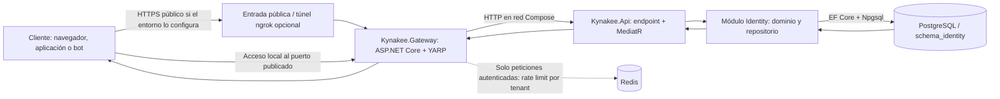
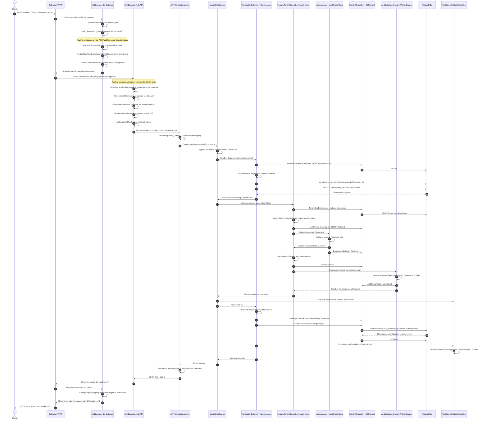
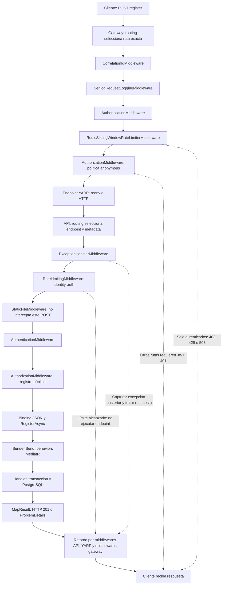
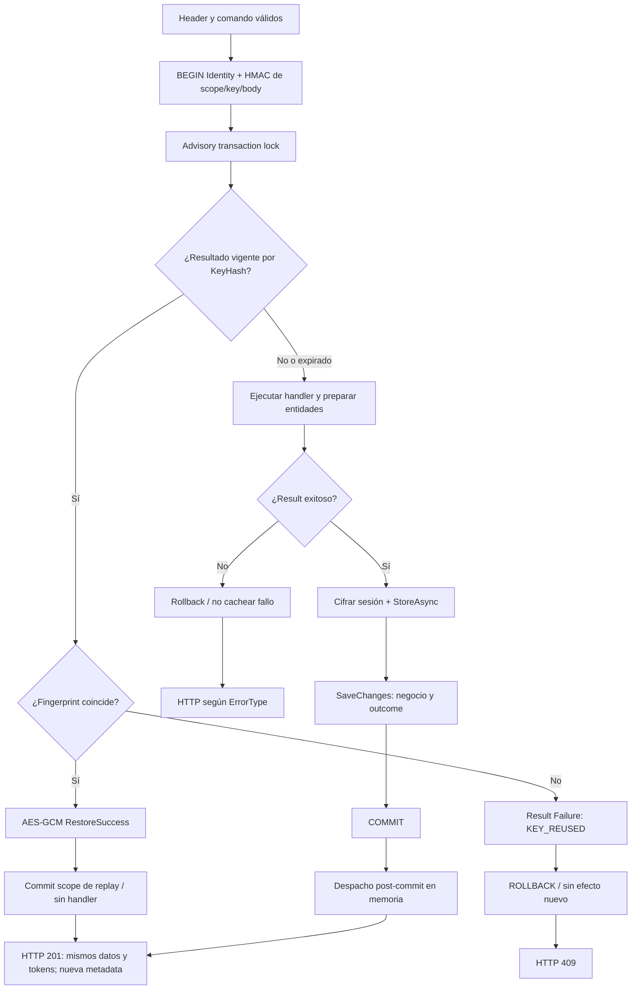
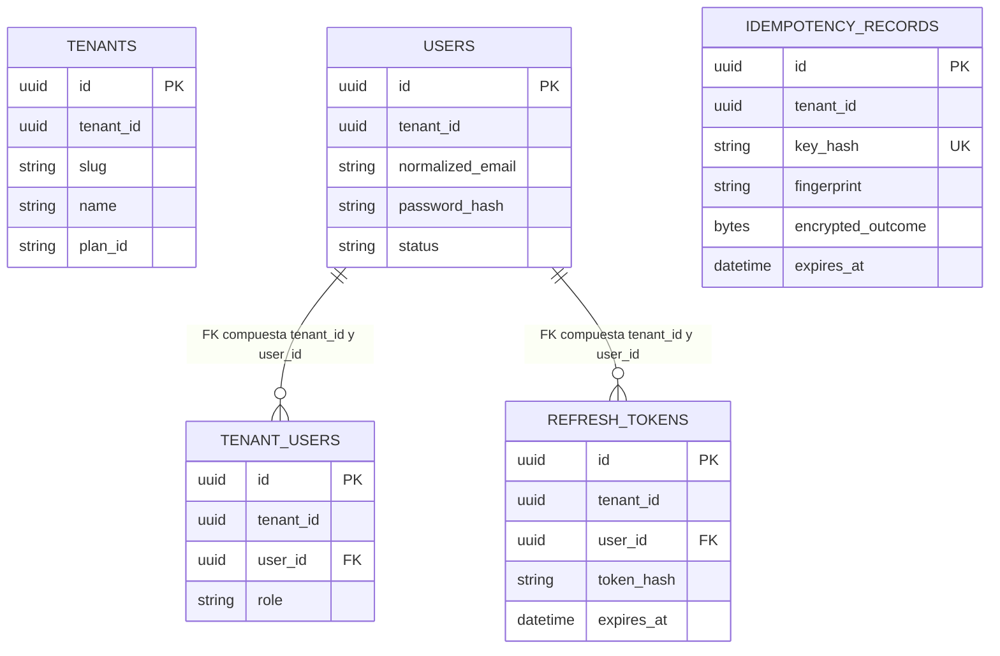

# Flujo de registro de tenant y propietario

## 1. Alcance y estado verificable

Este documento describe `POST /api/v1/identity/auth/register`, desde la preparación de la petición en el cliente hasta la respuesta HTTP. Se basa en el código del repositorio, no en una implementación supuesta del cliente `kynakee-web`.

- **Implementado:** endpoint, validación, creación de tenant/propietario, sesión, persistencia transaccional e idempotencia HTTP local de Identity.
- **Gateway corregido:** los POST exactos de registro, login, refresh, logout y aceptación de invitación tienen política YARP `anonymous`; el catch-all tiene `default` y sigue requiriendo autenticación. No se ha abierto todo `/auth`.
- **Compilación:** la solución compiló en la comprobación anterior de esta sesión; el proyecto de integración compiló tras la corrección del gateway.
- **Pruebas dirigidas ejecutadas:** 10 de gateway con destino HTTP efímero, 10 de headers de idempotencia Identity, 3 del pipeline idempotente, 3 del protector y 5 de persistencia PostgreSQL 17. Son pruebas separadas: no demuestran un recorrido completo cliente → gateway → API → PostgreSQL con registro real.
- **Migración:** `20261009022444_InitialIdentitySchema` generada, compilada y sin cambios pendientes de modelo en la comprobación previa; **no aplicada a ninguna base de datos**. Las pruebas PostgreSQL citadas usan `EnsureCreated`, no esa migración.
- **Pendiente:** operación real de extremo a extremo, retención con purga física, recuperación durable de efectos post-commit e integración Identity → Billing/Outbox/transport.

Consultar también [contratos HTTP](KynakeeApiContracts.md) y [guía de garantías por módulo](../Gobernanza/Garantias-transversales-por-modulo.md). Este documento precisa el comportamiento observado aunque otros documentos aún describan partes como objetivos pendientes.

## 2. Topología: qué proceso recibe cada salto

### Artefactos de infraestructura

| Artefacto | Responsabilidad real |
| --- | --- |
| [Gateway/Program.cs](../../src/Kynakee.Gateway/Program.cs) | Arranca el host público; configura JWT, correlación, Redis, autorización y `MapReverseProxy()`. El gateway es un proyecto independiente, no una parte de la API. |
| [Gateway/appsettings.json](../../src/Kynakee.Gateway/appsettings.json) | Define rutas públicas exactas con verbo POST, ruta catch-all autenticada y cluster `api-cluster`. Destino por defecto: `http://localhost:8080/`. |
| [docker-compose.dev.yml](../../docker/docker-compose.dev.yml) | Publica el gateway, mantiene la API interna y sobrescribe el destino YARP a `http://kynakee-api:${API_HTTP_PORT}/`. ngrok apunta al gateway. No arranca `kynakee-web`. |
| [API/Program.cs](../../src/Kynakee.Api/Program.cs) | Configura middlewares del host interno y registra los endpoints Identity. |
| [AddApiDependencies](../../src/Kynakee.Api/KynakeeApiDependenceExtensions.cs) | Punto global de composición DI: módulos, protector, autenticación, MediatR, behaviors, transacciones y excepción HTTP. |
| [AddIdentityModule](../../src/Kynakee.Modules/Kynakee.Modules.Identity/IdentityModuleDependencyExtensions.cs) | Implementación de registro del módulo: DbContext Npgsql, repositorio, participante transaccional, UserManager/store, tokens y validadores. |

DNS, TLS y la terminación HTTPS dependen del entorno; no hay que deducir su operación a partir de este diagrama. En desarrollo con ngrok, el túnel entrega al gateway. El repositorio del cliente es independiente: no se afirma uso de cookies, localStorage ni un método frontend concreto.

## 3. Petición y estructuras de entrada

### 3.1 Contrato del cliente

1. Recoger los datos de propietario, organización, plan y canal.
2. Generar una `Idempotency-Key` impredecible con al menos 128 bits de entropía, codificada Base64URL sin padding.
3. Enviar POST con `Content-Type: application/json`, `Idempotency-Key` y, opcionalmente, `X-Correlation-ID`.
4. Para reintentar una operación cuya respuesta se perdió, conservar **la misma clave y el mismo contenido**. Cambiar el contenido con la misma clave provoca conflicto si ya existe un éxito vigente.
5. No registrar contraseña, clave idempotente ni tokens. El almacenamiento seguro de la sesión en el cliente queda fuera de lo revisado aquí.

El servidor comprueba sintaxis y longitud de la clave; no puede demostrar que un cliente haya generado realmente 128 bits de entropía.

### 3.2 Body → `RegisterTenantOwnerCommand`

El binding JSON de Minimal APIs construye el [record del comando](../../src/Kynakee.Modules/Kynakee.Modules.Identity/Application/Commands/RegisterTenantOwner/RegisterTenantOwnerCommand.cs):

| Campos | Tipo CLR | Uso |
| --- | --- | --- |
| `FirstName`, `LastName` | `string` | Nombres del propietario. |
| `Email`, `Password`, `Phone` | `string` | Identidad, contraseña transitoria y teléfono. |
| `TenantName` | `string` | Nombre de organización y origen del slug. |
| `TenantType` | `TenantType` | Enum del dominio; debe pertenecer al enum. |
| `TaxId`, `TaxCountry` | `string` | Identificador fiscal y país alfa-2. |
| `FiscalCountry`, `FiscalRegion`, `FiscalProvince`, `FiscalMunicipality`, `FiscalPostalCode`, `FiscalStreet` | `string?` | Dirección opcional; si se proporciona algún dato, se exige el conjunto obligatorio. |
| `PlanId`, `Channel` | `string` | Plan declarado y canal `web`, `telegram` o `whatsapp`. |
| `IdempotencyContext` | `HttpIdempotencyContext?` | Metadato técnico establecido en servidor, con `[JsonIgnore]`; no proviene del JSON. |

`ICommand<IdentitySessionResponse>` hace que MediatR espere `Result<IdentitySessionResponse>`. `IHttpIdempotentCommand` habilita el protocolo idempotente únicamente cuando el endpoint proporciona contexto. La contraseña se utiliza para crear el hash del usuario y calcular una huella HMAC; no se persiste como texto en el registro de usuario ni en el registro de idempotencia.

## 4. Secuencia completa del primer registro exitoso

El diagrama representa una petición que supera los controles de entrada y alcanza un esquema disponible. El contenido SQL concreto de los INSERT lo genera EF/Npgsql: no se fija aquí su orden físico de batching.

### 4.0 Pipeline HTTP: middlewares y cortocircuitos

Los middlewares son componentes ASP.NET Core que envuelven la petición HTTP. Los behaviors de MediatR son otra tubería, ejecutada dentro del endpoint al llamar a `ISender.Send`; no son middlewares HTTP.

`UseRouting` no aparece como llamada explícita en estos `Program.cs`: `WebApplication` integra el routing de endpoints y la selección de metadata antes de los middlewares configurados. Por eso el gateway conoce la política YARP de la ruta y la API conoce la metadata `identity-auth` cuando se ejecutan autorización y rate limiting. El orden posterior reproduce los registros explícitos de cada host. Un middleware que responde anticipadamente no llama al siguiente componente; en ese caso no se llega al endpoint/MediatR ni a PostgreSQL. `ExceptionHandlerMiddleware` envuelve los componentes posteriores de la API y convierte las excepciones no controladas según la configuración del host; los resultados de negocio se traducen en el endpoint mediante `MapResult`. En el retorno no se ejecutan una segunda autenticación ni un segundo registro de negocio.

### 4.1 Recepción en el gateway

- `CorrelationIdMiddleware.InvokeAsync` acepta un único `X-Correlation-ID` no vacío, sin caracteres de control y de hasta 128 caracteres; en caso contrario genera un GUID. Lo coloca en petición, respuesta y `LogContext`.
- `UseAuthentication` intenta validar JWT si hay credenciales. La política `anonymous` de la ruta exacta permite el POST de registro sin JWT; otros verbos o rutas caen en el catch-all protegido.
- `RedisSlidingWindowRateLimiterMiddleware.InvokeAsync` **no limita solicitudes no autenticadas**. Para autenticadas limita por `tenant_id`; puede devolver 403 por tenant ausente, 429 o 503 si Redis falla. No atribuir esa protección Redis al registro anónimo.
- YARP reenvía al cluster API. Las pruebas de gateway verifican conservación de body y `Idempotency-Key`; no se afirma una transformación de esos datos.

### 4.2 Host API y endpoint

En `Program.Main` se registran `UseExceptionHandler`, `UseRateLimiter`, `UseStaticFiles`, `UseAuthentication` y `UseAuthorization`. El endpoint de registro no exige autorización y tiene `RequireRateLimiting("identity-auth")`.

`AddApiDependencies` configura `identity-auth` como ventana fija de 10 peticiones por minuto por `RemoteIpAddress`, sin cola. Esa IP puede ser la del proxy si no hay configuración de forwarded headers; no se ha verificado aquí identificación del cliente detrás del gateway. El endpoint declara 429 en OpenAPI, pero no hay un `RejectionStatusCode` explícito en esa configuración: no debe deducirse que el middleware devuelve efectivamente 429 por la declaración OpenAPI.

`IdentityEndpoints.MapIdentityEndpoints` registra el nombre OpenAPI `RegisterTenantOwner` y éxito 201. `RegisterAsync` realiza:

1. `ReadIdempotencyContext(context, "identity.register", Guid.Empty, Guid.Empty)`.
2. `IsValidIdempotencyKey`: 22–128 caracteres ASCII Base64URL, longitud decodificable y al menos 16 bytes.
3. Si falta o es inválida: `Results.Problem` 400 con `IDENTITY_IDEMPOTENCY_KEY_REQUIRED` o `IDENTITY_IDEMPOTENCY_KEY_INVALID`, sin enviar a MediatR.
4. Clona el record mediante `with` para añadir `IdempotencyContext`.
5. `ISender.Send` y, cuando retorna, `MapResult(..., 201)`.

El binding puede rechazar JSON no deserializable antes de entrar al método. El endpoint no crea entidades ni guarda en base de datos.

### 4.3 Pipeline MediatR: entrada y retorno

Los behaviors envuelven la ejecución en este orden; el retorno se desenrolla en orden inverso:

| Orden | Clase / método | Acción durante el registro |
| --- | --- | --- |
| 1 | `LoggingBehavior.Handle` | Mide duración y establece `TenantId`, `UserId`, `CorrelationId`, `ProjectId` en Serilog. Registra el nombre del comando, no su body. Para registro anónimo los identificadores de tenant/usuario aún están vacíos; no equivale al tenant nuevo. |
| 2 | `ValidationBehavior.Handle` | Ejecuta `IValidator<RegisterTenantOwnerCommand>.ValidateAsync`. Devuelve `VALIDATION_001` si hay fallos, antes de iniciar la transacción. |
| 3 | `TenantIsolationBehavior.Handle` | En anónimo inicializa `HttpTenantContext` con `Guid.Empty`, `Guid.Empty`, `false`. Si un principal autenticado carece de claims válidos, devuelve `TENANT_001`. No asigna el nuevo tenant al contexto global durante este registro. |
| 4 | `TokenGateBehavior.Handle` | El comando no implementa `IRequiresCredits`; llama a `next` sin reservar ni consumir créditos. |
| 5 | `TransactionBehavior.Handle` | Abre el scope Identity; coordina lock, replay, ejecución, outcome cifrado y commit. |
| 6 | `DomainEventDispatchBehavior.Handle` | Ejecuta handler; al regresar un éxito recoge los eventos y encola su despacho. **No los publica antes del commit**. |

El replay se decide en el behavior 5: los behaviors 1–4 ya se han ejecutado, pero no se entra al behavior 6 ni al handler de registro.

### 4.4 Validaciones antes del dominio

`RegisterTenantOwnerCommandValidator` y `IdentityPasswordRules.StrongPassword` verifican:

- Nombres no vacíos, hasta 100 caracteres; tenant hasta 200.
- Email y teléfono a través de los constructores de Value Objects.
- Contraseña de al menos 12 caracteres, mayúscula, minúscula, dígito y carácter no alfanumérico.
- `TenantType` válido; `TaxId.Create` con país de dos letras.
- Dirección completamente omitida: válida. Si se informa algún campo: país, municipio, código postal y calle obligatorios; región y provincia opcionales.
- `PlanId` no vacío hasta 100 caracteres; canal admitido.

Validar `PlanId` como string no demuestra existencia del plan en Billing ni creación de una suscripción.

### 4.5 Caso de uso y métodos del dominio

`RegisterTenantOwnerCommandHandler.Handle` utiliza cuatro dependencias: `IIdentityRepository`, `UserManager<User>`, `IIdentityTokenService` y `TimeProvider`.

1. Construye `Email`, `PhoneNumber`, `TaxId`, `Address` opcional y `CompanyBranding` mediante sus métodos `Create`; cada uno devuelve `Result`.
2. `CreateAvailableTenantSlugAsync` genera el slug con `CreateSlugBase`, consulta `TenantSlugExistsAsync` y, si hace falta, intenta alternativas con sufijo GUID (hasta tres intentos). La preconsulta no sustituye al índice único.
3. `Tenant.Create` crea el agregado activo, con `TenantId == Id`, `CompanySettings.Default`, dirección opcional y evento `TenantCreatedDomainEvent`.
4. `User.Create(..., null, UserStatus.Inactive)` crea el propietario aún sin hash. `AddTenant` lo incorpora al ChangeTracker.
5. `UserManager.CreateAsync(user, Password)` aplica las reglas de ASP.NET Core Identity y su hasher. `IdentityUserStore.SetPasswordHashAsync` llama a `User.SetPasswordHash`; **ese método no emite el evento de registro**.
6. `IdentityUserStore.CreateAsync` verifica email global mediante `FindUserByEmailAcrossTenantsAsync` y llama a `AddUser`. No hace `SaveChanges`.
7. `User.Activate` verifica estado y hash, activa el usuario y emite `UserRegisteredDomainEvent`.
8. `TenantUser.Create(user, UserRole.Owner)` establece la membresía; `AddTenantUser` la rastrea.
9. `IdentitySessionFactory.Create` crea refresh token, JWT y DTOs. El `Result` exitoso todavía está en memoria: falta confirmar la transacción.

`MapIdentityFailure` convierte DuplicateEmail a conflicto `IDENTITY_EMAIL_ALREADY_REGISTERED` y otros errores Identity a validación `IDENTITY_USER_CREATION_FAILED`.

### 4.6 Sesión y protección de credenciales

`IdentitySessionFactory.Create` llama a:

| Método | Resultado y destino |
| --- | --- |
| `JwtIdentityTokenService.GenerateOpaqueToken` | 64 bytes criptográficamente aleatorios, codificados Base64URL: refresh token en claro solo para la respuesta/cifrado de replay. |
| `JwtIdentityTokenService.HashToken` | SHA-256 hexadecimal del refresh token; es el valor almacenado en `refresh_tokens.token_hash`. No es el hash de contraseña. |
| `RefreshToken.Create` | Entidad con `UserId`, `TenantId`, hash y expiración de 30 días. `AddRefreshToken` la rastrea. |
| `JwtIdentityTokenService.CreateAccessToken` | JWT firmado HS256; issuer/audience configurados; claims `sub`, `tenant_id`, email y role; vida de 900 segundos. |
| `IdentitySessionFactory.MapUser / MapTenant` | Proyecta las entidades recién creadas en DTOs, sin nueva lectura de base de datos. |

Hay tres protecciones distintas: hash de contraseña administrado por Identity, hash SHA-256 de token aleatorio y HMAC/AES-GCM del protocolo idempotente. Ninguna autoriza a registrar sus entradas sensibles en logs.

## 5. Transacción e idempotencia: cuándo se consulta y cuándo se escribe

### 5.1 Clases de coordinación

- `ModuleTransactionManager.BeginAsync(typeof(RegisterTenantOwnerCommand), ct)` selecciona un único `IModuleTransactionParticipant` por `CanHandle`.
- `IdentityTransactionParticipant.CanHandle` identifica el ensamblado Identity; `BeginTransactionAsync` inicia la transacción del mismo `IdentityDbContext` y devuelve `IdentityModuleTransactionScope`.
- `IdentityHttpIdempotencyProtector.CreateRequest` deriva `KeyHash` y `Fingerprint`. Scope del registro: `identity.register`, tenant vacío y caller vacío. La huella usa el JSON del comando con opciones web, excluyendo el contexto técnico; no realiza una normalización semántica general de valores de negocio.
- `AcquireLockAsync` ejecuta `SELECT pg_advisory_xact_lock(hashtextextended(KeyHash, 0))`. El lock vive hasta finalizar la transacción, no es una fila persistida de claim.
- `AcquireAsync` consulta por `KeyHash` usando `IgnoreQueryFilters`, necesario para el scope anónimo; la separación de operación/caller/tenant está dentro del HMAC. Una coincidencia no expirada devuelve huella y ciphertext.
- `StoreAsync` añade `IdentityIdempotencyRecord` o reemplaza el existente para la misma clave después de la expiración.
- `CommitAsync` llama primero a `SaveChangesAsync` y luego a `CommitAsync` de la transacción Npgsql. Efectos de negocio y outcome quedan en el mismo commit.
- `RollbackAsync` revierte y limpia el ChangeTracker. Un `Result` fallido no se guarda para replay; un fallo de infraestructura anterior al commit tampoco deja un claim durable completado.

### 5.2 Formato del resultado protegido

`IdentityHttpIdempotencyProtector` deriva tres claves distintas desde `Authentication:SigningKey` con separación de dominio: clave de HMAC de idempotency key, clave de HMAC de fingerprint y clave AES del outcome.

`ProtectSuccess` serializa solo `Result<T>.Value`, no el wrapper `Result` ni `TraceId/Timestamp`. Cifra mediante AES-GCM y concatena:

| Segmento | Tamaño |
| --- | --- |
| Nonce | 12 bytes aleatorios |
| Tag de autenticación | 16 bytes |
| Ciphertext | Longitud del JSON de la sesión |

`RestoreSuccess` autentica/descifra y reconstruye `ResultFactory.Success<IdentitySessionResponse>`. El registro guarda tokens únicamente dentro del ciphertext. La expiración se calcula como `UtcNow.AddHours(24)` justo antes del commit, no mediante un reloj confirmado por PostgreSQL.

**Límites:** no existe purga global programada de expirados. Rotar `Authentication:SigningKey` cambia también hashes y clave de cifrado: una repetición puede dejar de localizar el registro anterior y ejecutar una operación nueva. La conservación/rotación de claves necesita un procedimiento propio; no se ha implementado un key ring versionado. Expirar el replay no revoca por sí mismo los tokens.

### 5.3 Diagrama de decisiones

Si dos peticiones llegan juntas, la segunda espera el lock y consulta después del commit de la primera. Si la primera revierte, la segunda puede ejecutar el handler. La prueba PostgreSQL utiliza dos conexiones/transacciones reales para verificar espera y lectura del outcome.

## 6. Datos persistidos y relaciones

Todas las entidades persistentes aquí descritas heredan de `BaseEntity<Guid>` directa o indirectamente: `Id`, `TenantId`, `CreatedAt`, `UpdatedAt`, `CreatedBy`, `UpdatedBy`, `DeletedAt`, `IsDeleted`. Las configuraciones añaden token de concurrencia PostgreSQL `xmin`.

El diagrama simplifica columnas de auditoría y Value Objects. `User.TenantId` asocia el usuario al tenant en el modelo; no se dibuja una FK a `TENANTS` no declarada en la configuración de usuario. La idempotencia anónima tiene `TenantId = Guid.Empty`, **no el ID del tenant recién creado**, y no tiene FK a ese tenant.

| Tabla `schema_identity` | Alta en el flujo | Mapeo / garantías |
| --- | --- | --- |
| `tenants` | `AddTenant` | `TenantConfiguration`: slug global único para no eliminados; check `tenant_id = id`. `Slug`, `TaxId`, `FiscalAddress`, `Branding`, `Settings` se mapean con `OwnsOne` a columnas de la misma tabla. Dirección fiscal opcional. |
| `users` | `IdentityUserStore.CreateAsync → AddUser` | `UserConfiguration`: email normalizado global único para no eliminados; contraseña como hash; estado Active después de activar. Email/teléfono son owned Value Objects. |
| `tenant_users` | `AddTenantUser` | `TenantUserConfiguration`: rol Owner; unicidad por `user_id`; FK compuesta al usuario y borrado restringido. |
| `refresh_tokens` | `AddRefreshToken` | `RefreshTokenConfiguration`: hash único; expiración y revocación, no token en claro. |
| `idempotency_records` | `IdentityModuleTransactionScope.StoreAsync` | `IdentityIdempotencyRecordConfiguration`: `key_hash` y `fingerprint` de 64 caracteres, ciphertext `bytea`, índice de expiración e índice único `ux_identity_idempotency_records_tenant_key` sobre **KeyHash únicamente**, que ya incluye el scope. |
| `user_invitations` | No se crea en registro | Pertenece al flujo de invitación, no al alta directa del propietario. |

`IdentityDbContext.OnModelCreating` configura `schema_identity`, carga `IEntityTypeConfiguration<T>` y aplica filtros de tenant/soft delete. El filtro de raíz Tenant exige `!IsDeleted && TenantId == Id`; no debe describirse como un filtro de tenant de petición idéntico al de Users. Las consultas de autenticación/slug entre tenants ignoran filtros con condiciones explícitas de no eliminado.

`AddTenant`, `AddUser`, `AddTenantUser` y `AddRefreshToken` solo rastrean entidades. No hay un commit individual por cada llamada. Los índices de email/slug son la protección real ante carreras con diferentes claves idempotentes: la prevalidación no garantiza exclusión.

## 7. Eventos y efectos posteriores al commit

1. `Tenant.Create` añade `TenantCreatedDomainEvent`; `User.Activate` añade `UserRegisteredDomainEvent` a sus agregados.
2. `DomainEventDispatchBehavior` usa `ModuleDomainEventCollector.Collect` y el participante Identity para recoger eventos del ChangeTracker.
3. Encola una acción mediante `PostCommitActionDispatcher.Enqueue`.
4. Tras commit, `TransactionBehavior` espera `ExecuteAsync(CancellationToken.None)`.
5. `MediatRDomainEventDispatcher.DispatchAsync` llama a `IPublisher.Publish` para cada evento de dominio y después se limpian los eventos recogidos.

Esto no es una publicación RabbitMQ ni un Outbox durable. No demuestra que Billing haya creado créditos o suscripción. El registro no llama al sender SMTP de invitaciones.

Si falla una acción post-commit, los datos y el outcome ya están confirmados; no se puede deshacer el registro. La primera respuesta puede fallar aunque haya commit. Un replay reproduce la sesión sin volver a ejecutar el handler ni recoger sus eventos; **no recupera los efectos externos omitidos**. Una caída entre commit y envío HTTP también puede dejar el registro creado con respuesta perdida: el outcome permite recuperar datos, no la entrega durable de eventos.

## 8. Retorno al cliente y estructuras de salida

`IdentityEndpoints.MapResult` recibe `Result<IdentitySessionResponse>` después de la transacción y devuelve `Results.Json` con status **201**, sin establecer explícitamente un header `Location`.

| Estructura | Campos |
| --- | --- |
| `Result<T>` | `IsSuccess`, `IsFailure`, `Value`, `Error`; wrapper interno de Application, no envelope HTTP completo. |
| `IdentitySessionResponse` | `AccessToken`, `RefreshToken`, `ExpiresIn = 900`, `TokenType = "Bearer"`, `User`, `Tenant`. |
| `IdentityUserProfile` | Id, TenantId, FirstName, LastName, Email, Phone, Role, Status. Version con `[JsonIgnore]`. |
| `IdentityTenantProfile` | Id, Name, Slug, Type, PlanId, Status, TaxId, TaxCountry, Settings, Branding. Version con `[JsonIgnore]`. No incluye la dirección fiscal en este DTO. |
| `IdentityCompanySettings` | Administration, Profit, Quality, SafetyHealth, Environment, Contingency. |
| `IdentityCompanyBranding` | CompanyName, PrimaryColor, LogoUrl, Email. |
| `ApiResponse<IdentitySessionResponse>` | `Data`, `TraceId = HttpContext.TraceIdentifier`, `Timestamp = DateTime.UtcNow`. |

En replay se conservan datos/tokens originales, pero se regenera el envelope HTTP. Un access token de 15 minutos puede estar caducado cuando se reproduce una sesión aún retenida durante 24 horas: no se emite uno nuevo para disimular esa expiración.

El `X-Correlation-ID` del gateway y el `TraceId` del body son distintos artefactos. El primero ayuda a correlacionar saltos; el segundo usa `HttpContext.TraceIdentifier` de la API. No se ha identificado en este flujo un método que copie automáticamente uno al otro.

El cliente recibe la respuesta reenviada por YARP y debe verificar status y body. Ante pérdida de respuesta debe reintentar con la misma clave dentro de la vigencia, sin asumir que un timeout implica rollback. Las políticas concretas de almacenamiento y renovación en `kynakee-web` no se verifican en este repositorio.

## 9. Caminos de error

| Punto | Resultado | ¿Efectos de negocio confirmados? |
| --- | --- | --- |
| Gateway, ruta privada/otro verbo sin JWT | 401; no llega al endpoint de registro. | No. |
| JSON no deserializable | Rechazo de binding antes del handler. | No. |
| Idempotency-Key ausente/inválida | 400 ProblemDetails con código Identity. | No. |
| FluentValidation | 400, `VALIDATION_001`. | No; no comenzó transacción. |
| Claims inválidos de un principal autenticado | 401, `TENANT_001`. | No. |
| Clave vigente reutilizada con contenido distinto | 409, `IDENTITY_IDEMPOTENCY_KEY_REUSED`. | No hay efecto nuevo. |
| Invariante/creación Identity falla | `Result.Failure` → rollback; 400/409 según error. | No. El fallo no se retiene para replay. |
| Carrera por email/slug durante SaveChanges | Rollback; handler HTTP de excepciones convierte solo restricciones permitidas a 409. | No. |
| Infraestructura falla antes del commit | Rollback cuando es posible; excepción conserva tratamiento de error. | No afirmar éxito; en fallos ambiguos de commit, reintentar misma clave para consultar outcome. |
| Despacho post-commit falla | Error tras commit. | Sí; replay de datos posible, recuperación de efectos externos no implementada. |

`IdentityUniqueConstraintExceptionHandler.TryHandleAsync` está ubicado bajo `Infrastructure/Identity`, pero su namespace es `Kynakee.Api.Infrastructure.ExceptionHandling`. Comprueba ruta Identity, SQLSTATE `23505`, esquema `schema_identity` y allowlist de restricciones. Traduce email, slug, membresía y hashes conocidos; no convierte toda excepción PostgreSQL indiscriminadamente en 409. Usa `IdentityPersistenceResources.resx` para los mensajes permitidos. Las precondiciones ETag/If-Match pertenecen a mutaciones de recursos existentes, no al POST de registro.

## 10. Índice de artefactos para navegar el código

| Archivo | Símbolos principales |
| --- | --- |
| [IdentityEndpoints](../../src/Kynakee.Api/Endpoints/IdentityEndpoints.cs) | MapIdentityEndpoints, RegisterAsync, ReadIdempotencyContext, IsValidIdempotencyKey, MapResult, ToProblem. |
| [Behaviors](../../src/Kynakee.Api/Application/Behaviors/) | Handle en Logging, Validation, TenantIsolation, TokenGate, Transaction y DomainEventDispatch. |
| [Command](../../src/Kynakee.Modules/Kynakee.Modules.Identity/Application/Commands/RegisterTenantOwner/RegisterTenantOwnerCommand.cs) | Datos de entrada y contexto ignorado en JSON. |
| [Validator](../../src/Kynakee.Modules/Kynakee.Modules.Identity/Application/Commands/RegisterTenantOwner/RegisterTenantOwnerCommandValidator.cs) | Reglas de entrada. |
| [Handler](../../src/Kynakee.Modules/Kynakee.Modules.Identity/Application/Commands/RegisterTenantOwner/RegisterTenantOwnerCommandHandler.cs) | Handle, CreateAvailableTenantSlugAsync, CreateSlugBase, HasFiscalAddress, MapIdentityFailure. |
| [IdentityUserStore](../../src/Kynakee.Modules/Kynakee.Modules.Identity/Infrastructure/IdentityUserStore.cs) | CreateAsync, SetPasswordHashAsync, FindByNameAsync, FindByEmailAsync; adaptación del dominio a UserManager. |
| [SessionFactory](../../src/Kynakee.Modules/Kynakee.Modules.Identity/Application/Commands/IdentitySessionFactory.cs) | Create, MapUser, MapTenant. |
| [TokenService](../../src/Kynakee.Modules/Kynakee.Modules.Identity/Infrastructure/JwtIdentityTokenService.cs) | GenerateOpaqueToken, HashToken, CreateAccessToken. |
| [Agregados](../../src/Kynakee.Modules/Kynakee.Modules.Identity/Domain/Aggregates/) | Tenant.Create, User.Create, User.SetPasswordHash, User.Activate. |
| [Entidades](../../src/Kynakee.Modules/Kynakee.Modules.Identity/Domain/Entities/) | TenantUser.Create, RefreshToken.Create. |
| [Repositorio](../../src/Kynakee.Modules/Kynakee.Modules.Identity/Infrastructure/Persistence/IdentityRepository.cs) | Consultas de unicidad, AddTenant, AddUser, AddTenantUser, AddRefreshToken. |
| [DbContext](../../src/Kynakee.Modules/Kynakee.Modules.Identity/Infrastructure/Persistence/IdentityDbContext.cs) | DbSets, OnModelCreating y filtros. |
| [Configuraciones EF](../../src/Kynakee.Modules/Kynakee.Modules.Identity/Infrastructure/Persistence/Configurations/) | Mapeos de columnas, índices, checks, relaciones y xmin. |
| [TransactionManager](../../src/Kynakee.Api/Infrastructure/Persistence/ModuleTransactionManager.cs) | BeginAsync y ResolveParticipant. |
| [Participante Identity](../../src/Kynakee.Modules/Kynakee.Modules.Identity/Infrastructure/Persistence/IdentityTransactionParticipant.cs) | CanHandle, BeginTransactionAsync, CollectDomainEvents, ClearDomainEvents. |
| [Scope Identity](../../src/Kynakee.Modules/Kynakee.Modules.Identity/Infrastructure/Persistence/IdentityModuleTransactionScope.cs) | AcquireLockAsync, AcquireAsync, StoreAsync, CommitAsync, RollbackAsync, DisposeAsync. |
| [Protector idempotente](../../src/Kynakee.Api/Infrastructure/Identity/IdentityHttpIdempotencyProtector.cs) | CreateRequest, ProtectSuccess, RestoreSuccess, CreateKeyReuseConflict. |
| [Contratos idempotentes](../../src/Kynakee.Modules/Kynakee.Modules.Shared/Contracts/IIdempotencyTransactionScope.cs) | HttpIdempotencyContext, IdempotencyRequest, IdempotencyLookupResult, interfaces del protocolo. |
| [Dispatcher post-commit](../../src/Kynakee.Api/Application/Abstractions/PostCommitActionDispatcher.cs) | Enqueue y ExecuteAsync. |
| [Dispatcher de dominio](../../src/Kynakee.Api/Application/Abstractions/MediatRDomainEventDispatcher.cs) | DispatchAsync mediante MediatR IPublisher. |
| [DTOs Identity](../../src/Kynakee.Modules/Kynakee.Modules.Identity/Application/Contracts/IdentityResponses.cs) | Sesión, perfiles, settings y branding. |
| [ApiResponse](../../src/Kynakee.Api/Endpoints/ApiResponse.cs) | Envelope HTTP con trazabilidad temporal. |
| [ExceptionHandler](../../src/Kynakee.Api/Infrastructure/Identity/IdentityUniqueConstraintExceptionHandler.cs) | TryHandleAsync, allowlist y mapeo seguro. |
| [Migraciones](../../src/Kynakee.Modules/Kynakee.Modules.Identity/Infrastructure/Persistence/Migrations/) | InitialIdentitySchema, Designer y snapshot generados; no evidencia de aplicación. |

## 11. Evidencias y límites de los diagramas

- [GatewayAuthenticationTests](../../tests/Kynakee.IntegrationTests/Gateway/GatewayAuthenticationTests.cs): cinco POST públicos reenviados con body/clave; cuatro casos protegidos y catch-all sin JWT. Destino Kestrel efímero, no API de negocio.
- [IdentityHttpIdempotencyEndpointTests](../../tests/Kynakee.IntegrationTests/Identity/IdentityHttpIdempotencyEndpointTests.cs): cinco rutas rechazan header ausente/malformado; no es prueba HTTP de registro exitoso/replay de sesión.
- [IdentityIdempotencyTransactionBehaviorTests](../../tests/Kynakee.UnitTests/Kynakee.UnitTests/Identity/Application/IdentityIdempotencyTransactionBehaviorTests.cs): replay, conflicto y concurrencia con scope simulado; no PostgreSQL.
- [IdentityHttpIdempotencyProtectorTests](../../tests/Kynakee.UnitTests/Kynakee.UnitTests/Identity/Application/IdentityHttpIdempotencyProtectorTests.cs): HMAC, cambio de huella y cifrado/restauración.
- [IdentityPostgresPersistenceTests](../../tests/Kynakee.IntegrationTests/Identity/IdentityPostgresPersistenceTests.cs): round-trip, restricciones y espera/replay con advisory lock real en PostgreSQL 17 efímero mediante `EnsureCreated`.

La diagramación representa el código y sus bifurcaciones; no sustituye a la prueba integrada de todos los saltos, al despliegue ni a la aplicación autorizada de la migración.
